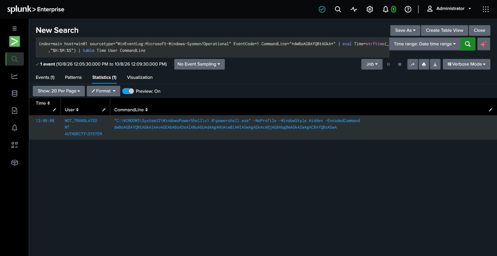

# 4. Timeline — the intrusion, reconstructed from evidence

This is the core of the investigation: a step-by-step account of what the attacker did and
when, built **only from the forwarded logs** — not from any prior knowledge of the attack.
Every row cites the evidence it rests on. Comparing it to the [ground truth](02-the-intrusion.md)
shows the reconstruction is accurate.

All times are from the host's own clock, in one continuous window. (Lab note: real
timestamps, compressed into a few minutes.)

## The timeline

| Time | Action | MITRE ATT&CK | Evidence |
|------|--------|--------------|----------|
| 12:06:01 | **Brute force begins.** 7 failed logons against the `analyst` account in one second — automated password guessing. | T1110.001 | Security **4625** ×7, target `analyst` |
| 12:06:03 | **The break-in.** A successful interactive logon as `analyst`, two seconds after the failures stop. The guessing worked. | T1078 / T1110.001 | Security **4624**, type 2, `analyst` |
| 12:06:08 | **Reconnaissance.** A Base64-encoded PowerShell command runs with a hidden window. Decoded, it's `whoami /all; net user; ipconfig /all` — the attacker mapping who they are, what accounts exist, and the network. | T1059.001 | Sysmon **1**, `-EncodedCommand` (decoded) |
| 12:06:25 | **Persistence #1 — autostart.** A registry Run key named `UpdateManager` is set to launch `C:\Windows\Temp\upd.exe` at every logon. | T1547.001 | Sysmon **13**, TargetObject `…\Run\UpdateManager` |
| ~12:07 | **Credential theft attempted — and blocked.** (See note below; no direct log, inferred from intent and the LSASS protection in place.) | T1003.001 | — (blocked at OS layer) |
| 12:08:02 | **Persistence #2 — backdoor account.** A new local account `helpdesk_svc` is created and added to the Administrators group. A second way back in, disguised as IT. | T1136.001 | Security **4720** + group change |
| 12:08:03 | **Persistence #3 — scheduled task.** A task `WindowsHealthMonitor` is registered to run every 15 minutes as SYSTEM. | T1053.005 | Security **4698** |
| 12:08:38 | **Covering tracks.** The attacker clears the Windows Security event log to destroy the record of everything above. | T1070.001 | Security **1102** |


## Decoding the hidden command

The reconnaissance step (12:06:08) was deliberately obscured — PowerShell run with
`-EncodedCommand` and a Base64 blob so a casual look wouldn't reveal it. Decoding the Base64
from the log turns it back into plain intent:

```
whoami /all   ->  what privileges does this account have?
net user      ->  what other accounts can I target or impersonate?
ipconfig /all ->  what network am I on, what can I reach next?
```

That's a textbook post-access orientation: *who am I, who else is here, where can I go.* It
tells the investigator the attacker was planning to go further, not smash-and-grab.



## A note on the credential-theft attempt

The attacker's behavior — encoded recon, multiple persistence mechanisms, a push for more
access — is consistent with an attempt to **steal more credentials and spread**. An attempt
to dump credentials from LSASS fits that pattern. It does **not** appear in these logs,
and that absence is itself informative: this host runs LSA protection, which blocks the
LSASS credential-dump technique at the OS layer. A blocked attempt grants no access, so it
generates no telemetry. The control stopped the theft — and, as a side effect, denied the
investigation a record of it. That's the argument for turning on Sysmon process-access
monitoring on machines where LSA protection isn't enabled (older Windows, most servers and
domain controllers), so the *attempt* is caught even when the theft is blocked.

## What the timeline establishes

In about two and a half minutes, the attacker went from outside the network to: logged in,
oriented, and holding **three independent forms of persistence** (a Run key, a backdoor
admin account, and a scheduled task), then wiped the local logs to hide it. This was not a
drive-by. Someone was setting up to stay — the early stage of exactly the kind of intrusion
that ends in ransomware or data theft if it isn't caught.
