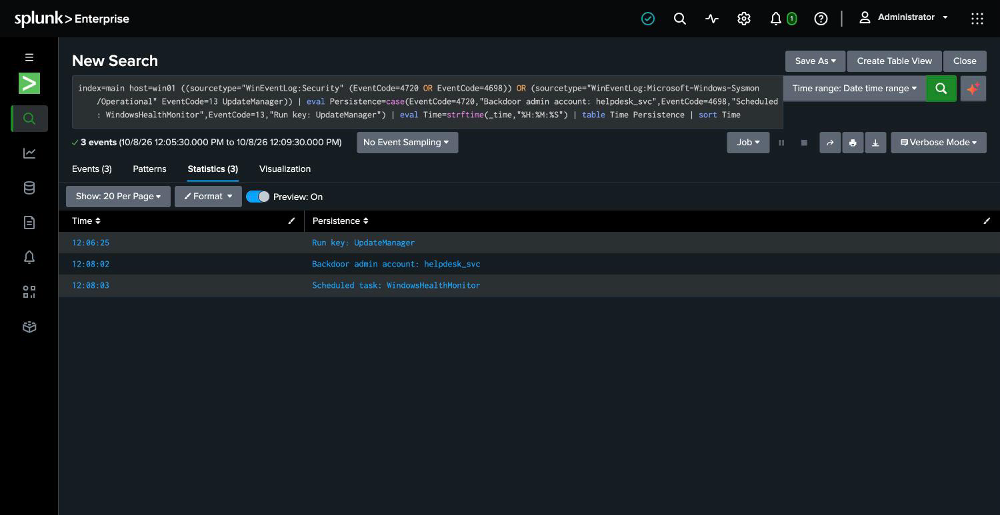

# 5. Forensic Artifacts — what the attacker left on the host

The timeline says what happened. This phase confirms it with the **physical evidence still
sitting on the machine**: the persistence the attacker planted, and proof that the local log
was destroyed. Each artifact is something a responder can see directly on the host, and each
one corroborates a line in the [timeline](04-timeline.md).

## Artifact 1 — Backdoor administrator account

```
Name:              helpdesk_svc
Enabled:           True
Member of group:   Administrators
```

A local account named to blend in with legitimate IT ("help desk service"), enabled, and a
full local administrator. It maps to the 4720 account-creation event at 12:08:02. This is
the attacker's **primary way back in** — even if the compromised `analyst` password is reset,
this account still works. It is the single most important thing to remove.

## Artifact 2 — Scheduled task

```
Task name:   WindowsHealthMonitor
State:       Ready
Runs as:     SYSTEM
Action:      cmd.exe /c powershell -NoP -W Hidden -Command exit
Schedule:    every 15 minutes
```

A scheduled task with an official-sounding name, running as **SYSTEM** (the highest
privilege on the machine) every 15 minutes. It maps to the 4698 event at 12:08:03. In a real
intrusion the action would re-launch the attacker's payload; here it's a harmless placeholder
standing in for it. A recurring SYSTEM task is a classic re-infection mechanism — kill the
malware and the task brings it back.

## Artifact 3 — Registry autostart (Run key)

```
HKLM\Software\Microsoft\Windows\CurrentVersion\Run
  UpdateManager = C:\Windows\Temp\upd.exe
```

An autostart entry that launches a program out of a temp folder every time someone logs in.
It maps to the Sysmon 13 event at 12:06:25. Two tells give it away as malicious: it points at
`C:\Windows\Temp` (legitimate software installs to Program Files, not a temp directory), and
the name `UpdateManager` is generic cover.

**Three independent persistence mechanisms** — a Run key, a scheduled task, and a backdoor
account. Removing one or two isn't enough; an attacker who plants three is counting on a
responder missing at least one. All three have to go.



## Artifact 4 — The destroyed local log

The clearest sign of a deliberate intruder: the local Security event log no longer contains
the attack. Its **oldest surviving entry is from after the time of the clear** — everything
before it, including the entire 12:06–12:08 intrusion, is gone from the machine.

```
Oldest events in the local Security log now:
  13:03:22   (long after the 12:08:38 clear)
  ...
```

If this host were the only source of evidence, the investigation would be nearly blind — the
attacker made sure of it. The reason the timeline above exists is that the logs were
**forwarded off the host in real time**, so the record was already safe in the SIEM before
the `wevtutil cl Security` command (event 1102) ever ran. The attacker destroyed the copy
they could reach and never touched the one that mattered.

## Corroboration

Every artifact lines up with a timeline entry built independently from the SIEM:

| Artifact on host | Timeline entry | Log evidence |
|------------------|----------------|--------------|
| `helpdesk_svc` admin account | Persistence #2, 12:08:02 | Security 4720 |
| `WindowsHealthMonitor` task | Persistence #3, 12:08:03 | Security 4698 |
| `UpdateManager` Run key | Persistence #1, 12:06:25 | Sysmon 13 |
| Wiped local Security log | Cover-up, 12:08:38 | Security 1102 |

The host evidence and the log evidence tell the same story from two directions. That's what
makes the finding defensible.
