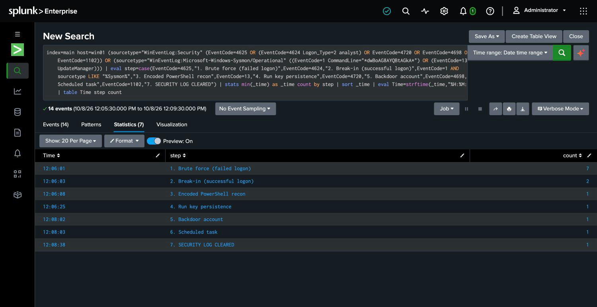

# Incident Report 01 — Anatomy of a Breach

A complete **digital forensics and incident response (DFIR)** investigation: an attacker
breaks into a Windows machine, and I work it like a real incident — reconstruct exactly what
they did from the evidence, explain how and why they got in, and lay out how to stop it
happening again.

It's the full response lifecycle on one page: **detect → triage → investigate → contain →
prevent → report.**

> Portfolio project. [Coquina Eye Care](01-scenario.md) is a fictional practice, the intrusion
> was simulated by me in a home lab, and no real systems or patient data are involved.

## The incident, in one paragraph

An attacker brute-forced a staff account's password on a Windows host, got in, ran encoded
reconnaissance, planted **three independent persistence mechanisms** (a registry Run key, a
backdoor administrator account, and a SYSTEM scheduled task), attempted to dump credentials
from LSASS, and cleared the Security log to cover their tracks — all in about two and a half
minutes. The credential theft was blocked by the host's LSA protection, and the attempt to
erase the evidence failed because the logs were forwarded off the host in real time. The full
intrusion was reconstructed from those forwarded logs.

## What this demonstrates

- **Timeline reconstruction** — rebuilding an attacker's actions, in order, from Windows
  Security logs and Sysmon telemetry, with each step mapped to MITRE ATT&CK.
- **Evidence handling** — working from an off-host log copy because the attacker destroyed the
  local one, and corroborating log evidence against artifacts on the host.
- **Forensic analysis** — decoding an attacker's obfuscated (Base64) PowerShell to recover
  their actual intent, and identifying persistence mechanisms by their tells.
- **Root-cause analysis** — separating "a weak password" from the real root cause (weak
  password **+ no MFA + exposed login**).
- **Incident response** — a containment/eradication/recovery plan, and a client-ready report.
- **Communication** — a technical investigation *and* a one-page summary a non-technical
  practice owner can act on.

## Read it in order

| Phase | Document |
|-------|----------|
| 1 | [Scenario](01-scenario.md) — the engagement: who, what, scope |
| 2 | [The intrusion](02-the-intrusion.md) — ground truth: exactly how the attack was run (reproducible) |
| 3 | [Triage](03-triage.md) — the first call: is this real? |
| 4 | [Timeline](04-timeline.md) — **the core** — the attack rebuilt from evidence, MITRE-mapped |
| 5 | [Forensic artifacts](05-forensic-artifacts.md) — what the attacker left on the host |
| 6 | [Findings](06-findings.md) — how they got in, what they touched, why it worked |
| 7 | [Containment & eradication](07-containment-eradication.md) — ending the incident |
| 8 | [**Incident report**](08-report.md) — executive summary + recommendations (the deliverable) |

## How this fits with my other work

This is the investigation side of a connected portfolio:

- **[home-lab-soc](https://github.com/SecByAlii/home-lab-soc)** is the detection lab — the SIEM
  and detections that *caught* this intrusion. This project is what happens after an alert
  fires.
- **[hipaa-risk-assessment](https://github.com/SecByAlii/hipaa-risk-assessment)** assessed this
  same fictional practice's risk *before* a breach. This investigation exercises several of
  the exact gaps it flagged — no MFA, weak credentials — and shows what they cost.

Find the risk before the breach, catch the breach when it happens, run it down afterward.
That's the job.

## Tools

Splunk (Windows Security log + Sysmon), MITRE ATT&CK, Windows host forensics, the detection
pipeline from [home-lab-soc](https://github.com/SecByAlii/home-lab-soc).
